<picture>
  <source media="(max-width: 600px)" srcset="assets/header-mobile.svg">
  
</picture>

<a href="#activity">Activity</a> · <a href="#contributions">Contributions</a>

## Activity

  <picture>
    <source media="(prefers-color-scheme: dark)" srcset="assets/overview-dark.svg">
    
  </picture>
  <picture>
    <source media="(prefers-color-scheme: dark)" srcset="assets/languages-dark.svg">
    
  </picture>

  <picture>
    <source media="(prefers-color-scheme: dark)" srcset="assets/activity-dark.svg">
    
  </picture>
  <picture>
    <source media="(prefers-color-scheme: dark)" srcset="assets/recent-dark.svg">
    
  </picture>

## Contributions

<picture>
  <source media="(prefers-color-scheme: dark)" srcset="assets/trail-dark.svg">
  
</picture>
